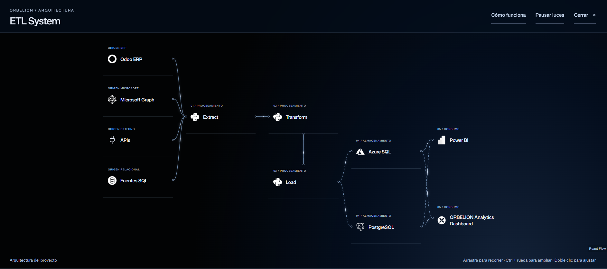
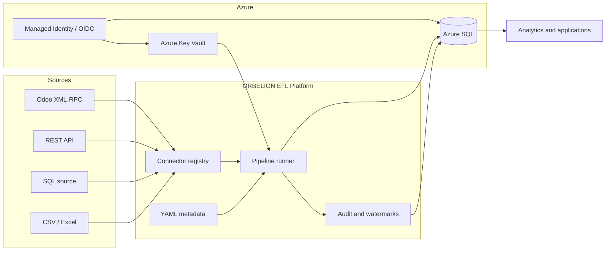
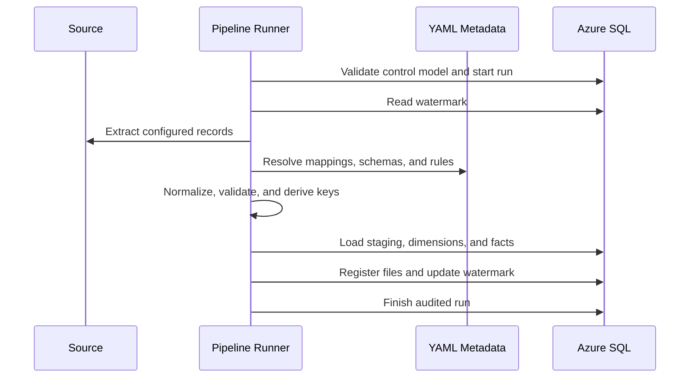

# ORBELION Integration & Automation Platform

## Overview

ORBELION ETL Platform is a metadata-driven Python data integration project for moving operational data into an Azure SQL analytical model. The public edition is an independent, sanitized portfolio repository: it contains only generic platform code, the synthetic `example_client`, and placeholder cloud configuration.

The repository demonstrates the implementation patterns present in the source platform without publishing customer data, production identifiers, credentials, schedules, or private operational playbooks.

## Business Problem

Organizations often receive operational data from different systems and formats while analytics teams need one consistent dimensional contract. Building a separate pipeline for every source creates duplicated mappings, inconsistent controls, and fragile deployments.

ORBELION separates reusable pipeline behavior from client metadata. Connectors extract records, YAML metadata maps and validates them, SQL loaders maintain staging/dimension/fact tables, and control tables record runs, processed files, and incremental watermarks.

## Solution

The platform provides:

- a Python ETL runner with explicit extract, transform, load, audit, and watermark steps;
- connector implementations for Odoo XML-RPC, REST APIs, SQL sources, CSV, and Excel;
- client-specific YAML metadata layered over reusable schemas and mappings;
- Azure SQL DDL for ETL control tables, a shared date dimension, Odoo analytics, and the analytical fact contract;
- an Azure OIDC and Key Vault configuration example with runtime placeholders;
- GitHub Actions examples using Azure OIDC and least-privilege job permissions;
- automated tests covering connectors, loading, dimensions, facts, watermarks, and pipeline behavior.

## Architecture

<p align="center">
  <a href="docs/assets/etl-workflow.png">
    
  </a>
</p>

The workflow asset presents the ORBELION ETL architecture from enterprise data sources through processing, storage, and analytical consumption.



See [Architecture overview](docs/architecture/overview.md) and [versioned Mermaid diagrams](docs/diagrams/system-context.md).

## Core Features

- Metadata-driven column mapping, schema coercion, required-field validation, derived columns, and deterministic business keys.
- Incremental control through persisted watermarks and file-processing records.
- Retry, pagination, rate-limit, and dynamic-auth support in the REST connector.
- Paginated Odoo extraction with model/field configuration and lookup enrichment.
- Idempotent SQL migration and analytical-model scripts.
- Example Key Vault naming contract: `{client-id}-odoo-url`, `{client-id}-odoo-database`, `{client-id}-odoo-username`, and `{client-id}-odoo-api-key`.

## Data Pipeline



The current SQL-source connector executes its configured query before the generic watermark filter is applied. Odoo incremental configuration uses the declared incremental field. These behaviors are documented as implementation boundaries rather than overstated as source-side change data capture.

## Multi-Client Architecture

`example_client` is the only distributed client configuration. It demonstrates the separation between reusable code and client metadata:

- `clients/example_client/` defines the client manifest;
- `configs/example_client/` defines source and destination pipelines;
- `metadata/**/example_client/` defines source mappings, schemas, and rules;
- client secrets are resolved dynamically and are never embedded in YAML.

Additional tenants follow the same folder contract while retaining isolated configuration and secret names.

## Technology Stack

| Area | Verified implementation |
|---|---|
| Language | Python 3 |
| Data processing | pandas |
| Metadata | YAML / PyYAML |
| Database | Azure SQL, SQLAlchemy, pyodbc, ODBC Driver 18 |
| Sources | Odoo XML-RPC, REST, SQL, CSV, Excel |
| Identity | Azure Identity for Azure SQL authentication |
| Secrets | Azure Key Vault configuration example |
| Delivery | Docker, GitHub Actions, Azure OIDC |
| Testing | pytest, HTTPX |

## Azure Architecture

GitHub Actions requests a short-lived Azure token through OIDC. The manual example grants `id-token: write` only to its identity-verification job, signs in through `azure/login`, and verifies that the externally configured Key Vault is reachable without reading secret values. Azure resource IDs and tenant IDs remain external variables.

The local demo requires no Azure resources. Cloud execution requires the manual configuration described in [Azure example deployment](docs/deployment/azure-example.md).

## GitHub Actions / CI-CD

- `ci.yml` runs the test suite, demo, and public-content scanner.
- `azure-oidc-key-vault-example.yml` is manual-only and demonstrates OIDC plus external Key Vault configuration.

There is no production schedule in this public repository.

## Security & Secrets Management

- No credentials or production infrastructure identifiers are stored in Git.
- `.env.example` contains empty placeholders only.
- `.env` and generated outputs are ignored.
- Key Vault names and Azure/Entra IDs are supplied at runtime.

## Monitoring & Logging

The ETL control model records run start/end status, processed counts, error state, watermarks, and processed files. Pipeline failures are associated with the active step and secret-like values are redacted from audit messages.

## Repository Structure

```text
ORBELION-ETL-Platform/
├── .github/workflows/        # CI and Azure OIDC examples
├── clients/example_client/   # Synthetic client manifest
├── configs/example_client/   # Odoo pipeline examples
├── ddl/                      # Control, warehouse, and migration SQL
├── demo/                     # Local synthetic CSV demonstration
├── docs/                     # Architecture, security, deployment, demo
├── etl_platform/             # ETL engine and connectors
├── metadata/                 # Mappings, schemas, rules, catalogs
└── tests/                    # Automated test suite
```

## Deployment Model

Local users can execute the synthetic demo directly. Azure deployments supply SQL, Key Vault, Managed Identity, and OIDC settings through environment configuration. The included Dockerfile packages the same synthetic demo as a non-root container.

## Testing

```bash
python -m pip install -r requirements.txt
python -m pytest -q
python -m demo.run_demo
```

The demo writes only generated synthetic output under `data/output/`, which is ignored by Git.

## Demo

The local demo extracts synthetic orders from CSV, applies the same metadata loader and transform engine used by the platform, generates deterministic business keys, and writes a transformed CSV.

```bash
python -m demo.run_demo
```

No network, database, cloud subscription, or credentials are required. See [Demo guide](docs/demo.md).

## Screenshots / Architecture Diagrams

Architecture diagrams are maintained as Mermaid so they remain reviewable and versioned with the code. No production screenshots or customer data are included.

## Roadmap

Potential production work is intentionally not implemented in this portfolio mirror. The private platform remains the source for operational remediation and release decisions.

## Author / Portfolio

Built as part of the ORBELION ecosystem to demonstrate practical Data Engineering, Cloud Engineering, automation, and analytics-platform design.
